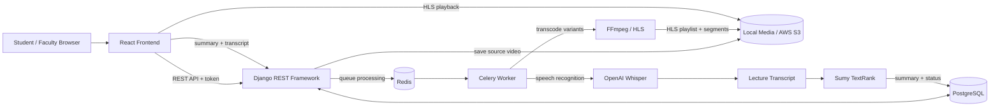
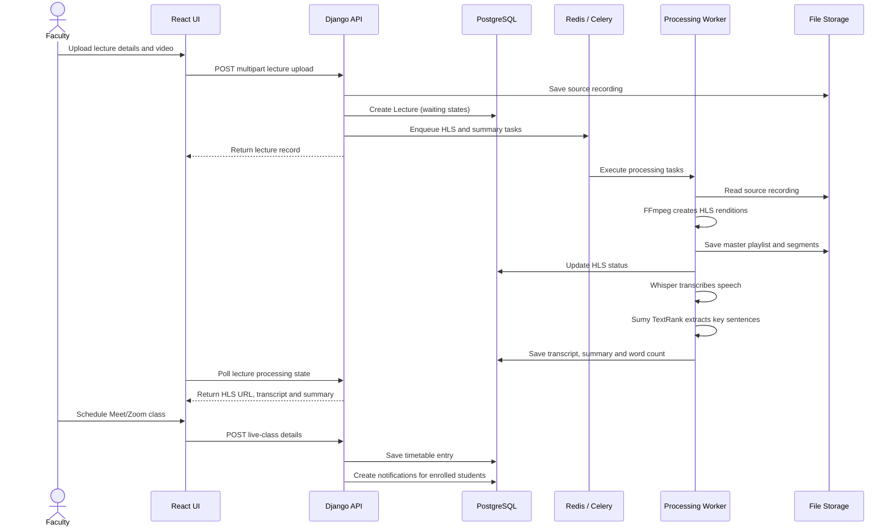
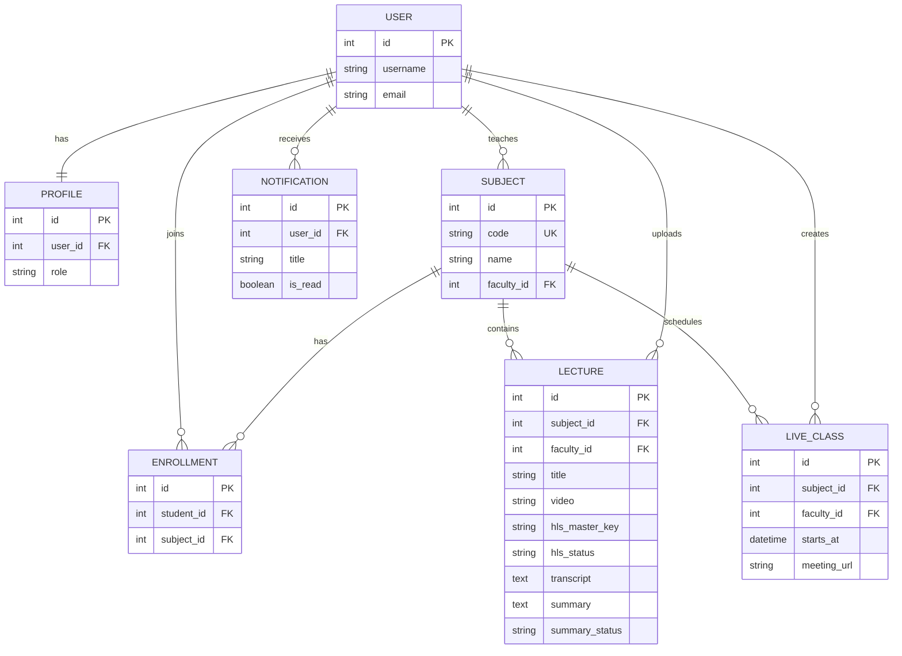

# System Architecture and Data Flow

## High-level architecture

## Request and processing sequence

## Database relationships

Question and Answer entities are deliberately not part of this Sprint I–III database baseline. They are planned for Sprint IV.

## Important engineering decisions

1. **Background tasks:** audio transcription and video conversion run in Celery workers. The HTTP upload request only validates and saves the lecture record; it does not wait for model inference or video encoding.
2. **Two separate processing states:** HLS and summary processing are tracked independently. A failed HLS conversion does not erase the uploaded source video or prevent an independent transcript/summary task.
3. **Access control:** public account registration creates a Student. Faculty accounts must be created by the administrator. Students must enroll before the API returns a subject's lectures or live classes.
4. **Data integrity:** PostgreSQL stores application records. Uploaded binaries and derived HLS files use the configured file storage backend.
5. **Lite Mode:** the summary is extractive and derived from the stored transcript. It is not a replacement for reviewing the original recording when exact wording is important.
